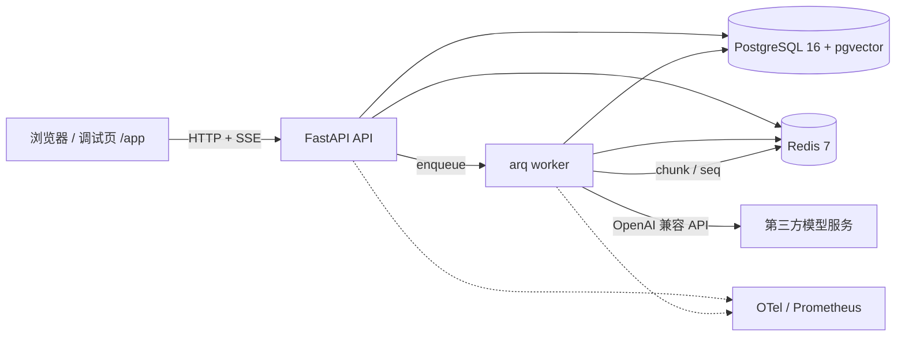

<div align="center">

# AI 网文创作平台 · 后端

**把 AI 写作从聊天框，变成一条有版本、有上下文、有质检、有成本的创作流水线。**

单用户 · 自托管 · 开源（MIT） · 面向中文网文作者与 AI 工程学习者

[](https://github.com/enshindev/webnovel-backend/actions/workflows/ci.yml)
[](https://www.python.org/)
[](https://fastapi.tiangolo.com/)
[](https://www.postgresql.org/)
[](https://redis.io/)
[](https://github.com/astral-sh/ruff)
[](https://mypy-lang.org/)
[](LICENSE)

<sub>A self-hosted backend for AI-assisted Chinese web-novel writing.</sub>

</div>

---

> **项目状态：v0.1 / Alpha。** S1–S5 主链路已完成；S6（多模态、本地模型、GraphRAG）与产品级前端尚未实现，HTTP 契约仍可能调整。适合自托管、学习与二次开发，不建议直接用于生产环境。

**目录：** [这是什么](#这是什么) · [核心特性](#核心特性) · [设计原则](#设计原则) · [架构](#架构) · [技术栈](#技术栈) · [快速开始](#快速开始) · [配置](#配置) · [API](#api) · [开发与测试](#开发与测试) · [项目结构](#项目结构) · [路线图](#路线图) · [文档](#文档)

## 这是什么

这是一个面向番茄小说作者的 **AI 网文创作平台后端**。它不是「输入一句话、吐出一本书」的黑盒，而是把创作拆成作者可以逐步确认的流水线：方向 → 设定 → 卷纲 → 章纲 → 初稿 → 修订 → 采纳 → 记忆 → 质检 → 导出。AI 每一步只负责一段，产物可保存、可编辑、可回滚，**作者始终保留最终写回权**。

它同时是一个 AI 工程实践项目：模块化单体、模型网关、prompt 版本治理、混合检索、离线评测、成本账本、OpenTelemetry 观测、outbox 与审计链。代码按「可测试、可替换、可回滚」组织，而不是把所有逻辑堆在路由里。

### 长篇写作真正难的地方

| 痛点 | 这个项目的回答 |
| --- | --- |
| 几十万字上下文塞不下，人物和设定越写越飘 | 摘要 / 实体 / 伏笔 / 时间线 + 向量与 BM25 混合检索；按 token 预算拼装上下文，并留下 `context_manifest` |
| 一次错误抽取会污染后面所有章节 | 记忆先产出 `change_proposal`，作者确认后才写回；摘要与向量绑定章节版本，版本变化自动标 `stale` |
| AI 直接改正文，改坏了无法回头 | 草稿采纳制；章节版本不可变；保存与采纳带 `base_version`，冲突直接 409 而不是静默覆盖 |
| 成本、延迟、失败原因不可见 | `usage_ledger`、单价快照、预算闸门、OTel/Prometheus、outbox 重试、hash 链审计 |
| 改一处 prompt，全线风格漂移 | prompt 文件为权威源 + label 指针；每次生成记录实际版本与 prompt/context 快照 |

### 适合谁

| 适合 | 不适合 |
| --- | --- |
| 想自托管一套写作助手的中文网文作者 | 想要开箱即用 SaaS 的用户 |
| 想研究 AI 应用工程的后端 / 全栈开发者 | 需要多租户、团队协作与权限体系的团队 |
| 想二次开发自己的写作工具、评测流程的人 | 需要本地大模型或完全离线推理的场景 |

## 核心特性

| 能力域 | 你能得到什么 |
| --- | --- |
| **创作主链路** | 作品 / 卷 / 章；不可变章节版本与乐观锁；SSE 流式续写、取消、重试；草稿采纳后才写入正文；生成可回放 prompt 与 context 快照 |
| **记忆与设定** | 章摘要、实体与关系、伏笔、时间线；采纳后异步抽取；实体去重生成 `entity_update` 建议；摘要/向量绑定版本，过期标 `stale` |
| **检索与上下文** | pgvector + 应用侧 BM25，经 RRF 融合；可选 rerank；按预算选择片段并记录 manifest；生成前自动注入相关设定与摘要 |
| **质检与导出** | 确定性机检（字数、缺章、格式、AI 味等）；LLM 审稿输出 P0/P1/P2 问题；发布前门禁；TXT/DOCX 导出、下载 token、末尾 AI 披露 |
| **文风与结构** | 文风声纹：确定性特征 + LLM 定性摘要、声纹检查、角色样本、strong rewrite；旧稿反向大纲：逐章摘要/节拍/钩子/问题 + 可编辑大纲 |
| **工作流编排** | 阶段化 `workflow_run`，人工 `advance` 或 `run-all` 异步自动推进；claim 锁避免重复执行；阶段产物可单独生成 |
| **助手与 Agent（实验）** | World Draft 版本、Project Brief、会话与 SSE 回复、只读工具调用；多步 agent executor、审批门、取消与恢复 |
| **作者资料库（实验）** | 集合 / 文档上传；txt、md、docx、pdf、图片解析（可选 OCR）；chunk + embedding + 检索与引用 |
| **成本与预算** | token / 模型 / 单价快照落账；按模型、任务、天聚合；每日预算 80% 警告、100% 阻断生成与审稿 |
| **可观测与治理** | OTel span 与 Prometheus `/metrics`；结构化日志不落正文；outbox 重试 / dead letter / webhook；审计日志 hash 链；prompt 目录同步与评测 CLI |

> `assistant`、`library` 等实验能力挂在 `/api/v1/experiments/*` 下，默认可用但不承诺稳定接口。

## 设计原则

1. **人在回路。** AI 产出只是草稿或变更建议；正文与设定库必须由作者采纳后才写入。
2. **只追加版本，不原地覆盖。** 章节版本、实体修订、prompt 版本都不可变；回滚是新增一条记录，而不是删除历史。
3. **机制与内容分离。** `src/webnovel/llm/` 只放可复用的 LLM 机制；具体 prompt 与黄金集放在根级 `prompts/`、`evals/`，可独立评审与回滚。
4. **单用户、少组件、可自托管。** 一个 Python 包、两个进程、PostgreSQL + Redis，不引入微服务与第二套消息系统。
5. **成本与可观测是一等公民。** 每次模型调用都有账本、有 span、有错误分类；日志默认 `NO_CONTENT`。
6. **边界由测试守住。** 分层依赖、跨模块 `contract`、prompt 目录与版本连续性都由 import-linter 和架构测试在 CI 中强制。

## 架构

### 运行时拓扑



**单包两入口的模块化单体。** API 与 worker 是两个进程，但共享同一个 `src/webnovel` 包。PostgreSQL 是唯一真相；Redis 只承担队列、SSE buffer 与短期租约。所有模型调用统一经过 `ModelClient` 网关，网关只做传输、流解析、路由与错误归一化，不渲染 prompt、不执行工具。

### 一次续写的完整路径

1. `POST /api/v1/works/{work_id}/generations` 写入 `queued` 任务，用 `Idempotency-Key` 防重复。
2. worker 认领任务，从记忆、检索与 prompt 目录组装上下文，记录 `context_manifest`。
3. 模型按流式返回，chunk 写入 Redis buffer，并周期性 checkpoint 到 `draft`。
4. `GET /generations/{id}/stream` 只是观察者：断开连接不等于取消，重连可用 `Last-Event-ID` 重放。
5. 作者采纳草稿 → 生成新的 `chapter_version` → 异步触发摘要、实体与向量抽取。

### 代码如何分层

| 目录 | 角色 | 依赖规则 |
| --- | --- | --- |
| `entrypoints/` | FastAPI API、arq worker、Typer CLI，唯一的组合根 | 可以 import 所有层 |
| `kernel/` | 纯原语与端口（`ModelClient`、`Clock`、`IdGenerator` 等） | 只依赖标准库 |
| `llm/` | 模型网关、上下文预算、prompt 渲染、检索融合、护栏、gen_ai 遥测 | 不依赖 `modules/` 与 `entrypoints/` |
| `infra/` | DB、Redis、配置、观测、鉴权与限流 | 不依赖 `llm/`、`modules/`、`entrypoints/` |
| `modules/` | 18 个业务模块，每个只通过 `contract.py` 暴露能力 | 跨模块只 import 对方的 `contract.py` |
| `evalkit/` | 离线评测与 judge | 运行时禁止 import |

业务模块包括：`works`、`chapters_versions`、`generation`、`memory`、`analysis`、`style`、`quality`、`export`、`library`、`workflow`、`usage`、`audit`、`outbox`、`prompts`、`assistant`、`agent`、`settings`、`volumes`。

内容不在 `src/` 里：`prompts/<module>/<task>/vNNN.yaml` 是不可变版本，`labels.yaml` 是可移动指针；`evals/<module>/<task>/cases.jsonl` 是黄金集；`knowledge/` 是 ideation 创作方法库。

## 技术栈

| 层 | 选型 |
| --- | --- |
| 语言 / 运行时 | **Python 3.12**（`uv` 管理依赖与 lockfile） |
| Web | **FastAPI** + Uvicorn + Pydantic v2 |
| 数据库 | **PostgreSQL 16** + **pgvector**（HNSW）；SQLAlchemy 2 async + Alembic |
| 队列 / 缓存 | **Redis 7** + **arq**（生成、抽取、导出、评测、工作流） |
| 模型接入 | `httpx` 自写 OpenAI 兼容 adapter；embedding / rerank 可选 |
| 可观测 | OpenTelemetry、Prometheus、structlog |
| 工程质量 | Ruff、mypy strict、import-linter、pytest、pre-commit、GitHub Actions |
| 许可 | MIT |

<details>
<summary><strong>刻意不选的技术，以及原因</strong></summary>

- **微服务 / K8s**：单用户自托管，没有独立扩缩、独立故障域或 GPU 需求；模块边界用 import-linter 强制即可。
- **Celery / Kafka / RabbitMQ**：arq + Redis 已能覆盖后台任务；可靠投递由 outbox 表承担，不需要第二套消息系统。
- **Qdrant / Milvus 等专用向量库**：单作品约 2k chunk，pgvector 与业务数据同库、同事务更简单。
- **厂商 SDK**：自写 OpenAI 兼容 adapter，统一流式、取消与错误语义，避免绑定单一供应商。
- **本地模型 / 微调**：当前无 GPU，统一走第三方 API；provider 可替换，未来只改 adapter 与 `config/routing.yaml`。

</details>

## 快速开始

### 前置条件

- Python **3.12** 与 [uv](https://docs.astral.sh/uv/)
- Docker + Docker Compose（或本机 PostgreSQL 16 + pgvector、Redis 7）
- 一个 OpenAI 兼容的模型 API；没有也可以先用 `fake` 模式跑通接口

### 启动

在仓库根目录执行：

```bash
# 1. 安装依赖（含测试与全部可选能力）
#    只想跑核心可用：uv sync --extra dev（集成测试会自动跳过）
uv sync --all-extras

# 2. 启动 PostgreSQL 16 + pgvector、Redis 7
docker compose up -d postgres redis

# 3. 配置
cp .env.example .env
cp config/pricing.example.yaml config/pricing.yaml
# 编辑 .env，至少填写：LLM_BASE_URL / LLM_API_KEY / LLM_MODEL

# 4. 建表
uv run alembic upgrade head

# 5. 启动 API（终端 A）
make dev            # 等价于 uv run webnovel serve --reload

# 6. 启动 worker（终端 B）；生成、抽取、导出都靠它执行
make worker         # 等价于 uv run webnovel worker
```

启动后可访问：

| 地址 | 内容 |
| --- | --- |
| <http://127.0.0.1:8000/docs> | Swagger UI / OpenAPI |
| <http://127.0.0.1:8000/app/> | 内置静态调试界面（World Draft / Analysis / Library） |
| <http://127.0.0.1:8000/health> | 健康检查 |
| <http://127.0.0.1:8000/metrics> | Prometheus 指标 |

### 没有模型 Key？

把 `.env` 改成 fake provider，就能在不调用真实模型的情况下走通接口、SSE 与页面：

```dotenv
LLM_PROVIDER=fake
LLM_MODEL=fake
```

fake 输出是固定文本，只用于本地联调与端到端测试。

### 可选观测栈

```bash
docker compose --profile observability up -d
```

```dotenv
OTEL_EXPORTER_OTLP_ENDPOINT=http://localhost:4318/v1/traces
```

Jaeger UI 在 <http://localhost:16686>，Prometheus 在 <http://localhost:9090>，Grafana 在 <http://localhost:3000>（默认 `admin / admin`）。

## 配置

### 环境变量

| 变量 | 必填 | 说明 |
| --- | --- | --- |
| `DATABASE_URL` | 是 | 默认使用 compose 中的 PostgreSQL |
| `REDIS_URL` | 是 | 默认 `redis://localhost:6379/0` |
| `LLM_BASE_URL` | 是（fake 除外） | OpenAI 兼容端点；`LLM_PROVIDER=fake` 时不需要 |
| `LLM_API_KEY` | 视供应商 | 密钥只放环境变量，不入库、不入仓 |
| `LLM_MODEL` | 是（fake 除外） | 模型名；`fake` 模式填 `fake` |
| `LLM_PROVIDER` | 否 | 默认 `openai-compatible`，可选 `fake` |
| `EMBEDDING_*` | 否 | 留空则关闭向量检索 |
| `RERANK_*` | 否 | 留空则关闭重排 |
| `DAILY_BUDGET` | 否 | 每日模型预算（元）；达到 100% 阻断生成与审稿 |
| `API_TOKEN` | 否 | 单用户 Bearer Token；对局域网/公网暴露时建议设置 |
| `RATE_LIMIT_PER_MINUTE` | 否 | 每客户端每分钟请求上限，`0` 表示关闭 |
| `OTEL_EXPORTER_OTLP_ENDPOINT` | 否 | 填写完整的 trace 端点，例如 `http://localhost:4318/v1/traces` |
| `PROMPTS_DIR` / `EVALS_DIR` | 否 | 默认根目录 `prompts/`、`evals/`；生产建议使用绝对路径 |

完整列表见 [`.env.example`](.env.example)。

### 配置文件

| 文件 | 作用 |
| --- | --- |
| `config/routing.yaml` | 任务到 provider 的路由与降级顺序 |
| `config/pricing.yaml` | 每百万 token 单价，用于成本账本与预算闸门（模板见 `pricing.example.yaml`） |
| `config/platform.yaml` | 平台规则：章节字数区间、更新节奏、AI 披露等 |
| `config/features.yaml` | 特性开关（例如多模态实验） |
| `prompts/`、`evals/`、`knowledge/` | 版本化 prompt、黄金集与创作方法内容 |

> **安全提示：** 默认只监听 `127.0.0.1` 且不启用鉴权。若要暴露到局域网或公网，请设置 `API_TOKEN`、开启 `RATE_LIMIT_PER_MINUTE`，并放在反向代理之后。不要提交 `.env`、`data/`、真实模型价格或任何密钥。

## API

- 在线文档：启动后访问 `/docs`（Swagger UI）；`/openapi.json` 可导出当前契约
- 共 80+ 个 HTTP 接口，覆盖作品、章节、生成、记忆、质检、导出、用量、工作流、资料库、助手与 Agent 实验

### 约定

| 约定 | 说明 |
| --- | --- |
| 前缀 | `/api/v1` |
| 错误格式 | RFC 9457 `application/problem+json`，包含 `code`、`request_id`、`retryable` |
| 幂等 | 创建生成任务必须带 `Idempotency-Key` |
| 并发 | 保存章节、采纳草稿带 `base_version`，冲突返回 409 |
| 鉴权 | 可选 `Authorization: Bearer <API_TOKEN>` |
| 流式 | `GET /generations/{id}/stream` 返回 SSE，支持 `Last-Event-ID` 重放 |

### 最小调用示例

```bash
# 1. 创建作品
curl -s -X POST http://127.0.0.1:8000/api/v1/works \
  -H 'Content-Type: application/json' \
  -d '{"title":"长夜灯火","genre":"悬疑"}'

# 2. 创建第一章（work_id 来自上一步）
curl -s -X POST http://127.0.0.1:8000/api/v1/works/<work_id>/chapters \
  -H 'Content-Type: application/json' \
  -d '{"number":1,"title":"雨夜","content":""}'

# 3. 发起续写（需要 worker 正在运行）
curl -s -X POST http://127.0.0.1:8000/api/v1/works/<work_id>/generations \
  -H 'Content-Type: application/json' \
  -H 'Idempotency-Key: demo-001' \
  -d '{"chapter_id":"<chapter_id>","task_type":"continue","target_words":2000}'

# 4. 观察流式输出
curl -N http://127.0.0.1:8000/api/v1/generations/<generation_id>/stream
```

## 开发与测试

| 命令 | 作用 |
| --- | --- |
| `make dev` | 启动 API（自动 reload） |
| `make worker` | 启动 arq worker |
| `make db-up` / `make db-down` | 启停 PostgreSQL + Redis |
| `make migrate` | `alembic upgrade head` |
| `make test` | 全量 pytest（含 PostgreSQL / Redis 集成，使用 pgserver / redislite） |
| `make lint` | Ruff + mypy strict + import-linter |
| `make fmt` | Ruff format |
| `uv run webnovel prompt-sync` | 把根级 `prompts/` 同步到数据库目录表 |
| `uv run webnovel eval --suite smoke` | 跑本地评测集并写入 `eval_runs` |

CI 位于 [.github/workflows/ci.yml](.github/workflows/ci.yml)：Ruff、mypy、import-linter、prompt 不可变性检查、Alembic 迁移、pytest、SSE 压测与备份恢复冒烟。

> 注：`test_published_prompt_files_are_not_modified` 需要 git 历史；未初始化 git 或浅克隆时会自动跳过。

## 项目结构

```text
.
├── src/webnovel/
│   ├── entrypoints/   # FastAPI API + arq worker + CLI（组合根）
│   ├── kernel/        # 原语与端口，不依赖框架
│   ├── llm/           # 网关 / 上下文 / prompt / 检索 / 护栏 / 遥测
│   ├── infra/         # DB / Redis / 配置 / 观测 / 安全
│   ├── modules/       # 18 个业务模块，只经 contract.py 交互
│   └── evalkit/       # 离线评测与 judge
├── apps/web/          # 静态调试界面（World Draft / Analysis / Library）
├── prompts/           # 版本化 prompt（内容权威源）
├── evals/             # 黄金集
├── knowledge/         # ideation 创作方法库
├── migrations/        # Alembic
├── config/            # 路由 / 定价 / 平台规则 / 特性开关
├── tests/             # unit / integration / architecture
├── scripts/           # 冒烟、备份、压测脚本
└── 根配置              # pyproject.toml / uv.lock / Makefile / compose.yaml
```

## 路线图

| 阶段 | 内容 | 状态 |
| --- | --- | --- |
| S1 | 生成闭环：作品 / 章节 / 版本 / 流式 / 取消 / 草稿采纳 | 已完成 |
| S2 | 记忆：摘要、抽取、向量、上下文构建 | 已完成 |
| S3 | 质检、文风声纹、反向大纲、导出 | 已完成 |
| S4 | 检索进阶、评测、成本账本与可观测 | 已完成 |
| S5 | 护栏、故事助手与 Agent 实验 | 已完成 |
| S6 | 多模态（ASR / TTS / 封面）、本地模型、GraphRAG | 可选 / 未实现 |
| — | 生产镜像与部署 Compose | 计划中 |
| — | 产品级前端 | 计划中 |

## 文档

- [贡献指南](CONTRIBUTING.md)
- [环境变量示例](.env.example)
- 架构、技术取舍与关键流程见本 README 的[架构](#架构)与[技术栈](#技术栈)章节
- 完整设计文档（设计包、ADR、OpenAPI 文件、DDL）不随公开仓库发布；接口以运行时 `/docs` 与 `/openapi.json` 为准

## 贡献

欢迎 Issue 与 PR。提交前请确保：

- `make lint` 与 `make test` 通过；
- 较大的架构或接口变更请先开 Issue 讨论；
- 修改 prompt 时新增 `vNNN.yaml` 并移动 `labels.yaml` 指针，不改已发布版本；
- 不提交 `.env`、`data/`、真实模型价格、密钥或第三方未授权内容。

## 许可与免责声明

本项目使用 [MIT License](LICENSE)。

- 与番茄小说官方无关；不抓取平台后台、不托管 Cookie、不自动代发。
- 生成的文本需由使用者自行校对并遵守发布平台的规则；导出文件会附带 AI 披露提醒。
- 模型调用产生的费用与内容合规责任由使用者承担。
- `third_party/` 仅作本地评估参考，未附 LICENSE，不随公开仓库发布，也不被 `src/` 依赖。

<div align="center">

如果这个项目对你有帮助，欢迎 Star、Issue 或 PR。

</div>
