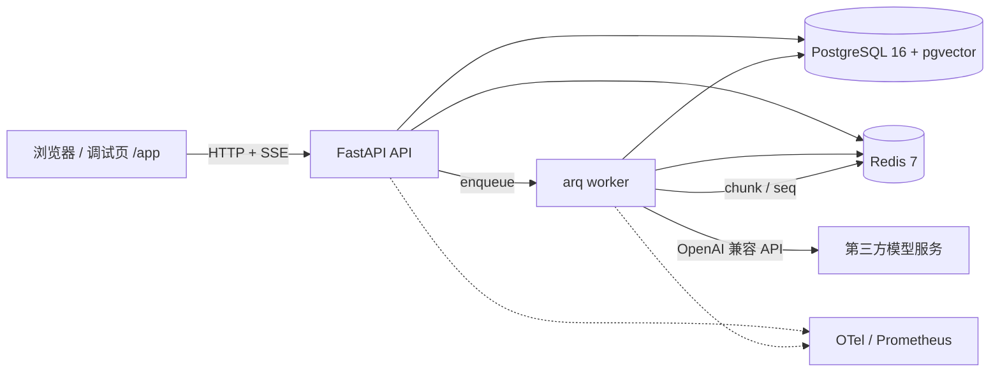

# webnovel-backend

自托管的 AI 网文写作后端。FastAPI + PostgreSQL/pgvector + Redis/arq，MIT。

[](https://github.com/enshindev/webnovel-backend/actions/workflows/ci.yml)
[](https://www.python.org/)
[](LICENSE)

> 项目还在 Alpha。主流程能跑，接口会改。没有正式前端，也不建议直接拿去做生产服务。

## 做什么

这是给中文网文作者用的写作后端。服务跑在自己机器上，模型接任意 OpenAI 兼容 API。作者管理作品、卷、章和设定，让 AI 出草稿或修改建议，确认之后才写回。

这个项目没有按“一句话生成一本小说”来做。连载写长以后，真正麻烦的是上下文和一致性：人物说过什么、伏笔埋在哪、这一章该收哪条线。把全文塞进 prompt 不现实，所以项目单独保存摘要、实体、关系、伏笔和时间线，生成时按 token 预算取用。

AI 不能直接改正文，也不能直接改设定库。正文走草稿采纳，设定走 proposal 确认。

## 功能

- 作品、卷、章和不可变章节版本。保存带 `base_version`，冲突返回 409。
- 续写、改写、扩写、润色、大纲等生成任务。任务在 worker 里跑，SSE 推送，可取消、重试、断线重连。
- 一次可以生成 1 到 4 个候选草稿，逐个对比后采纳；采纳一个，其余自动丢弃。
- 草稿采纳后才写入新章节版本。每次生成会记录 prompt 和 context 快照。
- 采纳章节后异步做摘要、实体、事件和知识状态抽取。变更以 proposal 返回，作者逐条确认。
- 故事状态可以按章节区间查事件，也能查某个角色在某一章知道、怀疑或不知道哪些事实；同章的状态冲突会进质检报告。
- pgvector 加 BM25，用 RRF 融合，可选 rerank。生成前按预算组装上下文，并留下 manifest。
- 检索和资料内容用 `<data>` 区块隔离，并做基础 prompt injection 标记，避免把资料当成指令。
- 机检字数、缺章、格式和 AI 味；LLM 审稿输出 P0/P1/P2 问题。导出 TXT/DOCX 前跑发布门禁，末尾附 AI 披露。
- 文风声纹 profile、声纹检查、角色样本和改写。旧稿可以导入做反向大纲。
- 工作流按阶段执行，可以人工确认，也可以 `run-all` 自动跑完。claim 锁防止重复执行。
- 每次模型调用记 token、模型和单价快照。支持按模型、任务、天聚合，以及每日预算。
- OTel span、Prometheus 指标、outbox 重试和 hash 链审计日志。
- 故事助手和资料库是实验功能，接口挂在 `/api/v1/experiments` 下；agent 接口在 `/api/v1/agent`，也还在实验阶段。
- 助手和 agent 的只读工具除了检索章节、查实体，也能查故事事件、`who_knows` 和一跳实体关系。

## 几个取舍

- API 和 worker 是两个进程，代码在同一个包里。没有拆微服务。
- 只做单用户。没有租户、团队和计费，部署只需要 PostgreSQL 和 Redis。
- 版本只追加。章节版本、实体修订和 prompt 版本都不覆盖。
- prompt 以文件为准。`prompts/` 是源，数据库只保存同步后的版本和 label 指针。
- 没上 Celery、Kafka、专用向量库和 K8s。当前规模用 arq、outbox 和 pgvector 够用。
- 模型调用都经过 `ModelClient`。网关只管传输、流解析、路由和错误归一化，不渲染 prompt，也不执行工具。

## 架构



API 处理 HTTP 和 SSE，worker 跑生成、抽取、质检、导出和工作流。PostgreSQL 存全部业务状态，Redis 只做队列、SSE buffer 和短期锁。

一次续写大致是这样：

1. `POST /api/v1/works/{work_id}/generations` 写入 `queued` 任务，用 `Idempotency-Key` 防重复。
2. worker 认领任务，从记忆、检索和 prompt 目录组装上下文，记录 `context_manifest`。
3. 模型流式返回，chunk 写入 Redis buffer，并定期 checkpoint 到 `draft`。
4. `GET /generations/{id}/stream` 只负责观察。断开连接不等于取消，重连可以用 `Last-Event-ID` 重放。
5. 作者采纳草稿，生成新的 `chapter_version`，再异步触发摘要、实体和向量抽取。

代码分层的规则：

| 目录 | 作用 | 依赖 |
| --- | --- | --- |
| `entrypoints/` | API、worker、CLI，唯一的组合根 | 可以 import 所有层 |
| `kernel/` | 原语和端口 | 只依赖标准库 |
| `llm/` | 网关、上下文、prompt、检索、护栏、遥测 | 不依赖 `modules/` 和 `entrypoints/` |
| `infra/` | DB、Redis、配置、观测、鉴权 | 不依赖 `llm/`、`modules/`、`entrypoints/` |
| `modules/` | 业务模块，只通过 `contract.py` 暴露 | 跨模块只 import 对方的 `contract.py` |
| `evalkit/` | 离线评测 | 运行时禁止 import |

业务模块有 `works`、`chapters_versions`、`generation`、`memory`、`analysis`、`style`、`quality`、`export`、`library`、`workflow`、`usage`、`audit`、`outbox`、`prompts`、`assistant`、`agent`、`settings`、`volumes`。

## 技术栈

| | |
| --- | --- |
| 语言 | Python 3.12 |
| Web | FastAPI、Pydantic v2、Uvicorn |
| 数据 | PostgreSQL 16、pgvector、SQLAlchemy 2 async、Alembic |
| 队列 | Redis 7、arq |
| 模型 | httpx 和自写的 OpenAI 兼容 adapter |
| 观测 | OpenTelemetry、Prometheus、structlog |
| 工具 | uv、Ruff、mypy strict、import-linter、pytest |

## 本地运行

需要 Python 3.12、[uv](https://docs.astral.sh/uv/) 和 Docker。模型需要一个 OpenAI 兼容 API；暂时没有也可以先用 fake。

```bash
uv sync --all-extras
docker compose up -d postgres redis

cp .env.example .env
cp config/pricing.example.yaml config/pricing.yaml
# 编辑 .env，填 LLM_BASE_URL、LLM_API_KEY、LLM_MODEL

uv run alembic upgrade head
make dev
```

另开一个终端跑 worker：

```bash
make worker
```

API 在 <http://127.0.0.1:8000>。Swagger 是 `/docs`，健康检查是 `/health`。`/app/` 下有几个调试页，不是正式前端。

没有模型 key 的话，把 `.env` 改成：

```dotenv
LLM_PROVIDER=fake
LLM_MODEL=fake
```

fake 返回固定文本，只适合联调接口和页面。

需要 trace 时可以起观测栈：

```bash
docker compose --profile observability up -d
```

然后在 `.env` 里设置：

```dotenv
OTEL_EXPORTER_OTLP_ENDPOINT=http://localhost:4318/v1/traces
```

Jaeger 在 <http://localhost:16686>，Prometheus 在 <http://localhost:9090>，Grafana 在 <http://localhost:3000>。

### Docker

```bash
cp .env.example .env
docker compose up -d --build
```

API 和 worker 都在 compose 里，启动时会自动跑 Alembic 迁移。数据放在 `appdata` volume，配置从 `./config` 只读挂载。

## 配置

常用变量：

| 变量 | 说明 |
| --- | --- |
| `DATABASE_URL` | PostgreSQL 连接串 |
| `REDIS_URL` | Redis 连接串 |
| `LLM_BASE_URL` | OpenAI 兼容端点 |
| `LLM_API_KEY` | 模型密钥 |
| `LLM_MODEL` | 模型名 |
| `LLM_PROVIDER` | 默认 `openai-compatible`，可设为 `fake` |
| `EMBEDDING_*` | embedding 服务。留空则关闭向量检索 |
| `RERANK_*` | rerank 服务。留空则关闭重排 |
| `DAILY_BUDGET` | 每日预算，单位元。到 100% 会阻断生成和审稿 |
| `API_TOKEN` | 可选的 Bearer token |
| `CORS_ORIGINS` | 逗号分隔的允许来源，留空不启用 |
| `LOG_JSON` | 生产环境可设为 `true`，输出 JSON 日志 |
| `LOG_LEVEL` | 日志级别，默认 `INFO` |
| `OTEL_EXPORTER_OTLP_ENDPOINT` | OTLP trace 地址，例如 `http://localhost:4318/v1/traces` |

完整列表见 [`.env.example`](.env.example)。

几个 YAML 配置：

- `config/routing.yaml`：任务到 provider 的路由和降级顺序。
- `config/pricing.yaml`：模型单价，按百万 token 计。从 `config/pricing.example.yaml` 复制。
- `config/platform.yaml`：章节字数、更新节奏、AI 披露等平台规则。
- `config/features.yaml`：特性开关。

默认只监听 `127.0.0.1`，也不开鉴权。要放到局域网或公网，至少设置 `API_TOKEN` 和 `RATE_LIMIT_PER_MINUTE`，前面再套一层反向代理。`.env`、`data/` 和真实价格不要提交。

## API

接口前缀是 `/api/v1`，启动后可以在 `/docs` 看完整列表，或者访问 `/openapi.json`。

创建生成任务必须带 `Idempotency-Key`。保存章节和采纳草稿要带 `base_version`，版本对不上会返回 409。错误响应是 RFC 9457 的 `application/problem+json`。

```bash
# 创建作品
curl -s -X POST http://127.0.0.1:8000/api/v1/works \
  -H 'Content-Type: application/json' \
  -d '{"title":"长夜灯火","genre":"悬疑"}'

# 创建第一章，work_id 用上一步返回的 id
curl -s -X POST http://127.0.0.1:8000/api/v1/works/<work_id>/chapters \
  -H 'Content-Type: application/json' \
  -d '{"number":1,"title":"雨夜","content":""}'

# 发起续写，需要 worker 在跑；candidate_count 可以取 1-4
curl -s -X POST http://127.0.0.1:8000/api/v1/works/<work_id>/generations \
  -H 'Content-Type: application/json' \
  -H 'Idempotency-Key: demo-001' \
  -d '{"chapter_id":"<chapter_id>","task_type":"continue","candidate_count":3}'

# 列出这次生成的候选草稿
curl -s http://127.0.0.1:8000/api/v1/generations/<generation_id>/drafts
```

## 开发

```bash
make fmt
make lint
make test
```

`make lint` 会跑 Ruff、mypy strict 和 import-linter。`make test` 会启动 pgserver 和 redislite，不需要额外开数据库。只跑单元测试可以用 `uv run pytest tests/unit`。

CI 在 [.github/workflows/ci.yml](.github/workflows/ci.yml)，会跑 lint、类型检查、迁移、测试、SSE 压测和备份恢复冒烟。

评测已经有一批 smoke 用例，按 `evals/<module>/<task>/cases.jsonl` 组织：

```bash
# 只登记用例，不评分
uv run webnovel eval --suite smoke

# 传入输出后按 expected_facts 做确定性评分
uv run webnovel eval --suite smoke --outputs outputs.jsonl
```

`outputs.jsonl` 每行是 `{"id": "case-id", "output": "..."}`。must-pass 用例没过时命令会返回 1。

也可以直接让模型跑评测，会按 `batch` profile 调模型并产生 token 成本：

```bash
uv run webnovel eval --run --suite smoke \
  --prompt-id generation/continuation --prompt-version 1 \
  --limit 3 --save-outputs outputs.jsonl
```

prompt 的规则是只加新版本，不改已发布的 `vNNN.yaml`。`labels.yaml` 负责指向当前版本。

跑过评测后可以晋升 label：

```bash
uv run webnovel eval --suite smoke --outputs outputs.jsonl \
  --prompt-id generation/continuation --prompt-version 2

uv run webnovel prompt-promote generation/continuation 2 --note "开头更稳"
```

`prompt-promote` 默认要求该 prompt/version 最近一次 eval run 的 gate 是 `passed`，否则拒绝。`--force` 跳过校验，`--dry-run` 只看变更。晋升会改 `labels.yaml`、同步数据库并写审计。

## 目录

```text
.
├── src/webnovel/
│   ├── entrypoints/   # API、worker、CLI
│   ├── kernel/        # 原语和端口
│   ├── llm/           # 网关、上下文、prompt、检索、遥测
│   ├── infra/         # DB、Redis、配置、观测、鉴权
│   ├── modules/       # 业务模块
│   └── evalkit/       # 离线评测
├── apps/web/          # 调试页
├── prompts/           # prompt 内容
├── evals/             # 评测集
├── knowledge/         # ideation 创作方法
├── migrations/        # Alembic
├── config/            # 路由、定价、平台规则、特性开关
├── tests/             # unit / integration / architecture
├── scripts/           # 冒烟、备份、压测
└── pyproject.toml     # 依赖和工具配置
```

## 进度

已经能用的：生成主流程、章节版本、记忆抽取、检索、质检、导出、文风声纹、反向大纲、工作流、用量账本、审计、outbox。

还没做：多模态（ASR、TTS、封面）、本地模型、GraphRAG、正式前端。生产镜像已经放在 `Dockerfile` 和 `compose.yaml`，但没有做 TLS、托管备份这些运维配套。

接口还没稳定。设计文档（架构、ADR、DDL）没有随仓库公开，实际接口以 `/docs` 为准。

## 贡献

有问题直接开 Issue。提交前请跑 `make lint` 和 `make test`。改 prompt 时加新版本，不要改已发布文件。

## License

MIT，见 [LICENSE](LICENSE)。

和番茄小说官方无关。项目不抓平台后台、不托管 Cookie、不自动发布。生成的文本需要自己校对并遵守发布平台规则，模型费用和内容责任也由使用者承担。
